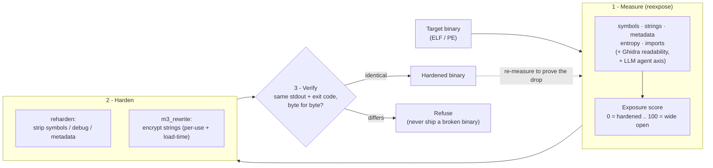

<div align="center">

# REN

### Reverse Engineer Nothing

**Measure how exposed a binary is to AI-assisted reverse engineering, remove what
the analyst reads, and prove behavior is unchanged. The inverse of
[REA](https://github.com/morluto/rea) (Reverse Engineer Anything).**


-blue?style=flat-square)


</div>

## Abstract

Reverse engineering is increasingly agent-driven: tools such as
[REA](https://github.com/morluto/rea), GhidraMCP and ida-pro-mcp let a large
language model read a binary, name its functions, explain a feature and
reconstruct it, working from the symbols, strings, debug metadata and recovered
control flow left in the file. **REN** is the inverse of that pipeline. It
(1) *quantifies* how cheaply such an analyst can understand a compiled binary,
(2) *removes* the signals the analyst anchors on, without source and without
changing behavior, and (3) *verifies* behavior preservation byte-for-byte on
every transformation. This document reports the design and measured results on
real ELF binaries (GNU coreutils and others) and on Windows PE binaries built
and executed under Wine on a Linux host.

It is a research prototype, not a product. Every technique raises the *cost* of
analysis; none makes it impossible. Its scope is protecting software you own; it
removes comprehension aids, it does not conceal what a program does from a
defender.

## 1. Motivation

A reverse engineer, human or agent, anchors on a small set of signals: symbol
names, string literals, debug and toolchain metadata, recognizable code
structure, and the decompiler's output. An LLM agent is especially dependent on
these, because its summaries are generated from exactly that recovered text.
Classic software protection targets the human and the decompiler; REN adds
an explicit model of, and defense against, the *agent* in the loop, and insists
on measurement: it reports exposure before and after, rather than asserting that
a transform helped.

### Flowchart



### How it works

1. **Measure.** `reexpose` reads a finished binary the way an analyst would and
   gives it an *exposure score*: how many names, strings, and metadata an agent
   could anchor on. Higher means easier to reverse engineer.
2. **Harden.** `reharden` deletes the metadata (symbols, debug info) the loader
   never needs; `m3_rewrite` encrypts the string literals so they are decrypted
   only at runtime. Neither touches what the program computes.
3. **Verify.** Every change is run against the original on sample inputs and
   compared byte for byte. If the output differs at all, the change is thrown
   away. You can only ever get back a binary that behaves exactly like the one
   you put in, or nothing.

Then measure again to see the score drop. That is the whole system.

## 2. Approach

### 2.1 Exposure model

`reexpose` assigns a 0-100 exposure score (0 hardened, 100 wide open) as a
weighted sum over five static axes computed from `nm`, `readelf`, `objdump` and
`strings`, plus two opt-in dynamic axes:

| Axis | Weight | Signal |
| --- | --- | --- |
| symbols | 30 | named functions/variables an agent navigates and names by |
| strings | 30 | landmark strings (keys, messages, URLs, source paths) for grep/xref |
| metadata | 25 | symbol table, debug sections, build-id, toolchain provenance |
| entropy | 10 | plaintext code on disk (low) vs packed/encrypted (high) |
| imports | 5 | library calls that give behavioral footholds |
| readability (`--deep`) | opt-in | Ghidra decompiler output quality (structure vs junk, flattening) |
| agent (`--agent`) | opt-in | whether a local LLM, given the decompiled function, recovers its mechanism and secrets |

### 2.2 Hardening

- **Metadata denial** (`reharden`): removes the symbol table, debug sections,
  build-id and toolchain notes from a finished binary. All removed sections are
  non-loadable, so behavior is untouched. ELF and PE.
- **String encryption** (`encrypt_strings`, `m3_rewrite`): encrypts string
  literals on disk and decrypts them at runtime. Two mechanisms: a LIEF-based
  entry-point stub, and a reference-correct GTIRB round-trip (below).

### 2.3 Reference-correct rewriting

`m3_rewrite` lifts the binary to GrammaTech GTIRB (via `ddisasm`), rewrites it,
and reassembles. Because the intermediate assembly keeps every reference
symbolic, inserting code and moving data stays consistent automatically. Two
cases are handled:

- **Per-use** (code references, `leaq (L)(%rip)`): each reference is rewritten
  to decrypt the string on use into a private buffer, so plaintext is only ever
  transiently resident.
- **Load-time** (pointer tables `.quad L` and clang relative-offset pools):
  the object is moved to a writable section and decrypted in place by an
  injected constructor.

### 2.4 Behavior-preservation gate

Every hardening step runs the original and the rewritten binary on sample inputs
and compares exit code and stdout **byte-for-byte**. A transform that changes
observable behavior is refused rather than emitted. The toolkit never produces a
binary that behaves differently from its input; unsupported constructs degrade
to a safe refusal.

## 3. Results

### 3.1 Exposure of unmodified binaries

Distribution binaries ship stripped (symbol axis near zero) but still leak
strings and metadata, scoring around 50 (grade D). An unstripped build scores
far higher.

| Binary | Exposure | Grade |
| --- | --- | --- |
| `/usr/bin/true` | 50.4 | D |
| `/bin/ls` | 51.5 | D |
| `/usr/bin/sort` | 52.1 | D |
| `/bin/grep` | 52.3 | D |
| lab `baseline` (unstripped) | 73.7 | F |

### 3.2 Metadata denial (`reharden`)

Behavior preserved (verified by execution; PE under Wine):

| Target | Before | After |
| --- | --- | --- |
| ELF, unstripped `baseline` | 73.7 (F) | 35.8 (C) |
| PE `license.exe` | 79.0 (F) | 47.9 (D) |

### 3.3 String-encryption coverage (`m3_rewrite --encrypt-strings`)

Behavior byte-identical in every non-refused case:

| Binary | per-use strings | load-time objects | behavior |
| --- | --- | --- | --- |
| `/usr/bin/true` | 48 | 0 | identical |
| `/usr/bin/base64` | 54 | 5 | identical |
| `/usr/bin/jq` | 65 | 0 | identical |
| `/usr/bin/sort` | 146 | 41 | identical |
| `/bin/ls` | 130 | 83 | identical |
| `/bin/bash` | 728 | 793 | identical |
| `/bin/grep` | 123 | 57 | **refused (gate)** |

`grep` exercises a reference pattern the current rewriter does not handle
correctly; the gate caught the resulting divergence and refused, rather than
emit a broken binary. A worked run:

```
$ m3_rewrite.py /usr/bin/base64 -o base64.enc --encrypt-strings --verify "--version" --verify "--help"
  GTIRB: ISA.X64 FileFormat.ELF  sections={'.rodata': 3680, '.data': 152, '.text': 14098}
  per-use: 54 strings / 73 refs rewritten to decrypt-on-use
  load-time: 5 objects (.quad tables + offset-table pools) decrypted by injected constructor
  verify ['--version']: OK (orig rc=0, out rc=0)
  verify ['--help']:    OK (orig rc=0, out rc=0)
```

After encryption, the meaningful application strings are absent from the file
(`strings base64.enc | grep -iE 'invalid|usage|cannot'` returns nothing). Note
a measurement caveat: the aggregate *strings-axis score* moves little (99.9 to
99.4 on `base64`), because it also counts untouched library/boilerplate strings
and the incidental printable runs in XOR ciphertext. The removal of
*application* landmarks is real; the current aggregate score under-credits it.
Refining the strings axis to weight application strings is future work.

### 3.4 The AI-specific axes

These are the clearest demonstrations of the thesis, measured on the same
`check_license` function in clean and control-flow-flattened form:

| Axis | clean | flattened |
| --- | --- | --- |
| decompiler readability (Ghidra) | 100.0 | 0.0 |
| LLM summary-accuracy (local `qwen2.5-coder:1.5b`) | 66.7 | 0.0 |

On the clean form the model recovers the mechanism and quotes the embedded
secret; on the flattened form Ghidra fails to recover control flow and the model
can say nothing specific. Critically, on a clean-vs-flattened comparison the five
static axes do not move (same symbols, strings, metadata), and only the agent
axis does. This is the signal classic protection metrics miss and the reason the
agent axis is the central contribution.

## 4. Usage

```
reexpose.py  <bin> [--json|--quiet] [--gate N] [--deep] [--agent FUNC --secret S]
reharden.py  <bin> -o <out> [--run "ARGS"]
m3_rewrite.py <bin> -o <out> --encrypt-strings [--verify "ARGS"]...
agent_summary.py <bin> --func FUNC --secret S
```

The repository's `make` targets (`scan`, `reharden`, `m3-encrypt`,
`readability-demo`, `agent-demo`, `pe-demo`) reproduce the results above on the
bundled worked example; see [docs/lab.md](docs/lab.md).

## 5. Implementation notes and limitations

- **ELF** is the complete surface: measurement, metadata denial and both
  string-encryption paths are validated on real binaries up to `bash`.
- **PE** can be built, run (Wine), measured and metadata-hardened on Linux;
  string encryption is blocked because `gtirb-pprinter` emits Microsoft `ml64`
  MASM for PE that the available assemblers cannot consume
  ([tools/pe/README.md](tools/pe/README.md)).
- **Mach-O** is not implemented.
- The strings-axis score under-credits string encryption (Section 3.3); merged
  `.ascii`-continuation strings are conservatively skipped; one real binary
  (`grep`) is refused.
- Hardening is cost-raising, not absolute. Runtime defenses (anti-debug,
  integrity checks) are deliberately omitted: they break legitimate users and
  trip antivirus, and belong only around a single asset with a graceful-degrade
  response.

## 6. Related work

- **The threat**: REA, GhidraMCP, ida-pro-mcp (LLM-over-decompiler agents);
  recent work on prompt injection against RE agents.
- **Rewriting**: GrammaTech GTIRB / `ddisasm` / `gtirb-pprinter`.
- **Obfuscation**: VMProtect, Themida, Tigress, obfuscator-LLVM (complementary;
  REN measures their effect via the readability and agent axes rather than
  reimplementing them).

## 7. Scope and ethics

REN protects software you own. It removes comprehension aids and raises
analysis cost. It must not be used to misrepresent what code does to a security
tool or to conceal malicious behavior. The measurement harness is kept honest
and independent by design: it reports exposure and conceals nothing.

## License

[PolyForm Noncommercial 1.0.0](LICENSE). Free to read, run, and modify for any
**noncommercial** purpose (evaluation, research, personal use, and by nonprofit
or government organizations). **Commercial or production use requires a separate
license** from the author; that is the intended path for companies that want to
use REN to protect their own software. Contact the author to arrange one.

## Documentation

- [docs/lab.md](docs/lab.md): the worked example and the optimizer lesson.
- [harness/README.md](harness/README.md): the exposure scanner and its axes.
- [tools/README.md](tools/README.md): `reharden`, `encrypt_strings`,
  `m3_rewrite`, `agent_summary`.
- [tools/pe/README.md](tools/pe/README.md): Windows PE support and its blocker.
- [docs/rodata-string-rewriting-spec.md](docs/rodata-string-rewriting-spec.md):
  string-rewriting design and milestones.
