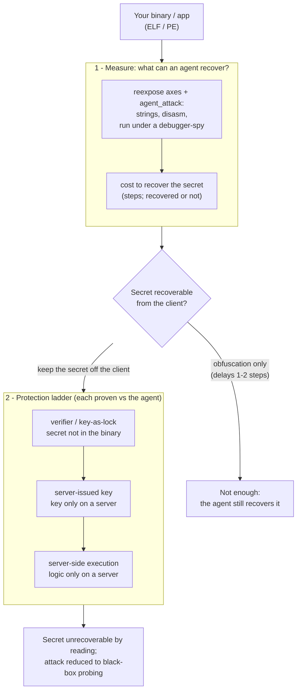

<div align="center">

# re-exposure

### An honest exposure meter for agent-driven reverse engineering

**How much can an AI agent actually recover from your compiled binary? re-exposure
measures it, shows that obfuscation barely slows the agent down, and gives you
the protections that hold. The defensive counterpart to agent RE tools like
[REA](https://github.com/morluto/rea).**


-blue?style=flat-square)


</div>

---

Reverse engineering is now agent-driven: [REA](https://github.com/morluto/rea),
GhidraMCP and ida-pro-mcp point a language model at a binary and it names
functions, explains features, and reconstructs logic. re-exposure is the other side of
that. It runs the same kind of agent at *your* binary, reports exactly how far
it gets, and shows that the one thing which actually stops it is not shipping the
secret.

## The result in one table

An iterating LLM agent (a local 32b model) with `strings`, `disasm`, and a
`run`-under-a-debugger tool, turned loose on the same program protected six ways:

| build | protection | agent cracked it? | how / when |
| --- | --- | --- | --- |
| plaintext | none | yes | step 1, read from `strings` |
| encrypted | XOR string encryption | yes | step 3, read off the `strcmp` at runtime |
| verifier | ships `SHA-256(key)`, not the key | **no** | nothing to read |
| locked | key-as-lock (AES-256-GCM asset) | **no** | no key, no gate to patch |
| online | server-issued key (server down) | **no** | key never in the client |
| compute | server-side execution (server live) | **no** | logic never in the client |

String encryption is defeated in two extra steps: the agent sees `strings`
return nothing, runs the binary, and reads the decrypted key off the comparison.
The four builds it cannot crack all share one trait, the secret is not in the
client. `make attack-demo` and `make compute-demo` reproduce this.

> You cannot make software that runs on someone else's machine
> un-reverse-engineerable, and an agent only makes the attacker cheaper. What you
> *can* do is not ship the secret. re-exposure measures the gap and walks you there.

## Quickstart

```bash
# 1. Measure a binary the way an agent reads it (needs binutils)
python3 harness/reexpose.py /usr/bin/ls

# 2. Watch an iterating agent try to crack three builds (needs a local Ollama
#    model, e.g. REEXPOSE_MODEL=qwen2.5-coder:32b)
make attack-demo

# 3. Walk the protection ladder (needs OpenSSL for the crypto tiers)
make locked-demo        # key-as-lock: the asset is ciphertext, the key decrypts it
make online-demo        # the key is issued by a license server; client holds a token
make compute-demo       # the secret logic runs server-side; client gets only results
```

## How it works



1. **Measure.** `reexpose` scores how much an analyst can anchor on (symbols,
   strings, metadata); `agent_attack` runs an actual tool-using LLM at the binary
   and reports the *cost to recover* the secret: how many steps, and whether it
   succeeds at all.
2. **Read the verdict honestly.** Classic hardening (strip, encrypt, flatten)
   moves that cost by a step or two. If the secret is in the client, the agent
   gets it. The measurement says so plainly, instead of letting you assume a
   transform helped.
3. **Climb the ladder** until the secret is off the client. Each rung is proven
   against the same agent (`cracked=false`).

Any binary-modifying step is gated: the output is run against the original and
compared byte for byte, and a transform that changes behavior is refused, never
emitted.

## The protection ladder

The hardening everyone sells is a cost-raiser. The protections that actually
deny an agent the secret all keep it out of the client, in increasing strength:

| rung | what it does | the catch it removes | demo |
| --- | --- | --- | --- |
| **Verifier** | ship `SHA-256(key)`, not the key | key is readable in the binary | `src/license_verifier.c` |
| **Key-as-lock** | asset ships as AES-256-GCM ciphertext; the key decrypts it | there is a plaintext asset / a gate to patch | `make locked-demo` |
| **Server-issued key** | the key lives on a license server; the client holds a token | the key still reaches the client | `make online-demo` |
| **Server-side execution** | the secret logic runs on the server; the client gets only results | the logic itself is in the client | `make compute-demo` |

Server-side execution is the ceiling. Its one residual exposure is black-box
probing (query the oracle and try to approximate it), which the server
rate-limits, logs, and can revoke. There is nothing beyond it, because any output
a client is allowed to see is information an attacker can collect.

## What gets measured

`reexpose` scores a binary 0 (hardened) to 100 (wide open) over five static axes,
plus opt-in dynamic ones:

| axis | weight | signal an agent anchors on |
| --- | --- | --- |
| symbols | 30 | named functions/variables to navigate and name by |
| strings | 30 | landmark strings (keys, messages, URLs, paths) for grep/xref |
| metadata | 25 | symbol table, debug sections, build-id, toolchain provenance |
| entropy | 10 | plaintext code on disk (low) vs packed/encrypted (high) |
| imports | 5 | library calls that give behavioral footholds |
| readability (`--deep`) | opt-in | Ghidra decompiler output quality (structure vs junk) |
| agent (`--agent`) | opt-in | whether a local LLM, given one function, recovers it |
| agent-attack | tool-using | an iterating agent's cost to recover (the table above) |

The bundled hardening transforms, metadata stripping (`reharden`) and string
encryption (`encrypt_strings`, `m3_rewrite`), are included as *measured
cost-raisers*, not as protection. They are useful against a human or a one-shot
tool; the numbers below show what they do and do not buy against an agent.

## Results

**Unmodified binaries** ship stripped but still leak strings and metadata
(~50, grade D); an unstripped build scores far higher.

| binary | exposure | grade |
| --- | --- | --- |
| `/usr/bin/true` | 50.4 | D |
| `/bin/ls` | 51.5 | D |
| `/bin/grep` | 52.3 | D |
| lab `baseline` (unstripped) | 73.7 | F |

**Metadata denial** (`reharden`), behavior preserved (PE verified under Wine):
ELF `baseline` 73.7 (F) to 35.8 (C); PE `license.exe` 79.0 (F) to 47.9 (D).

**String-encryption coverage** (`m3_rewrite --encrypt-strings`), behavior
byte-identical in every non-refused case:

| binary | per-use | load-time | behavior |
| --- | --- | --- | --- |
| `/usr/bin/true` | 48 | 0 | identical |
| `/bin/ls` | 130 | 83 | identical |
| `/bin/bash` | 728 | 793 | identical |
| `/bin/grep` | 123 | 57 | **refused (gate caught a divergence)** |

After encryption the application strings are gone from the file, though the
aggregate strings-axis score moves little because it also counts untouched
library strings and incidental printable runs in ciphertext (a known
under-crediting, see [tools/README.md](tools/README.md)). The point is not the
score; it is that running the binary still hands the agent the plaintext, which
is why string encryption sits in the "cost-raiser" column, not the ladder.

**The decompiler-vs-agent correction.** On the same `check_license`, clean vs
control-flow-flattened, what the agent is *given* changes everything:

| what the model sees | clean | flattened |
| --- | --- | --- |
| Ghidra pseudocode (one-shot) | 75.0 | 0.0 |
| raw disassembly | 41.7 | 25.0 |
| disassembly + the binary's strings | 91.7\* | 75.0\* |

\* = the model reproduced the literal key. The flattened `0` is not protection,
it is Ghidra failing to structure the code and handing the model a stub. Feed the
model what an agent actually reads (disassembly, then the strings) and the
flattened column climbs `0 -> 25 -> 75`. Control-flow flattening does not stop an
agent, because the secret was never in the control flow. Reproduce with
`make benchmark`.

## Limitations and scope

- **ELF** is the complete surface: measurement, metadata denial, and both
  string-encryption paths are validated on real binaries up to `bash`.
- **PE** can be built, run (Wine), measured, and metadata-hardened on Linux;
  PE string encryption is blocked on the MSVC assembler toolchain
  ([tools/pe/README.md](tools/pe/README.md)). **Mach-O** is not implemented.
- Hardening is cost-raising, not absolute, which is the whole point of measuring
  it. Runtime defenses (anti-debug, integrity checks) are deliberately omitted:
  they break legitimate users and trip antivirus.
- The crypto/server tiers are demonstrations: they speak plain HTTP to localhost
  and take a static token. Production needs TLS, a signed and device-bound token,
  short-lived keys, and rate-limiting on the compute oracle.
- Scope is protecting software **you own**. re-exposure removes comprehension aids and
  moves secrets off the client; it is not for concealing what a program does from
  a security tool or a defender. The measurement harness conceals nothing by
  design.

## Related work

- **The threat:** REA, GhidraMCP, ida-pro-mcp (LLM-over-decompiler agents).
- **Rewriting:** GrammaTech GTIRB / `ddisasm` / `gtirb-pprinter`.
- **Obfuscation:** VMProtect, Themida, Tigress, obfuscator-LLVM. re-exposure measures
  their effect rather than reimplementing them, and the measurement is why it
  treats them as cost-raisers, not protection.

## License

[PolyForm Noncommercial 1.0.0](LICENSE). Free to read, run, and modify for any
**noncommercial** purpose (evaluation, research, personal use, and by nonprofit
or government organizations). **Commercial or production use requires a separate
license** from the author, the intended path for companies that want to use re-exposure
to protect their own software. Contact the author to arrange one.

## Documentation

- [docs/lab.md](docs/lab.md): the worked example and the optimizer lesson.
- [harness/README.md](harness/README.md): the exposure scanner and its axes.
- [tools/README.md](tools/README.md): `reharden`, `encrypt_strings`,
  `m3_rewrite`, `agent_summary`, `agent_attack`, and the protection-ladder tools.
- [tools/pe/README.md](tools/pe/README.md): Windows PE support and its blocker.
- [docs/rodata-string-rewriting-spec.md](docs/rodata-string-rewriting-spec.md):
  string-rewriting design and milestones.
